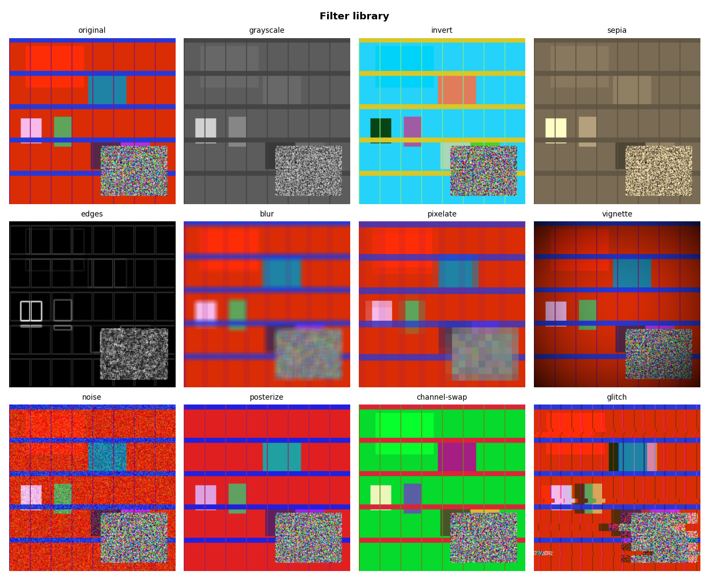
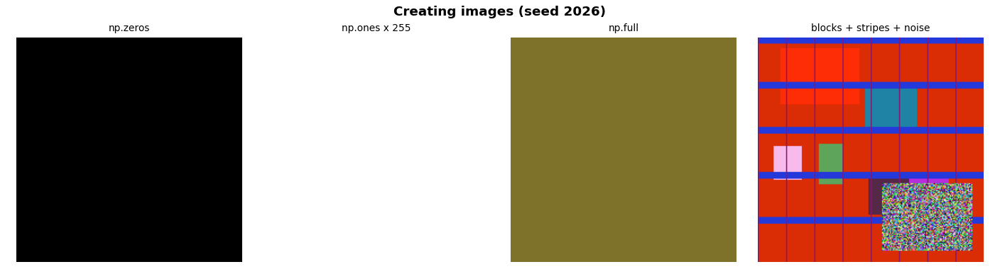
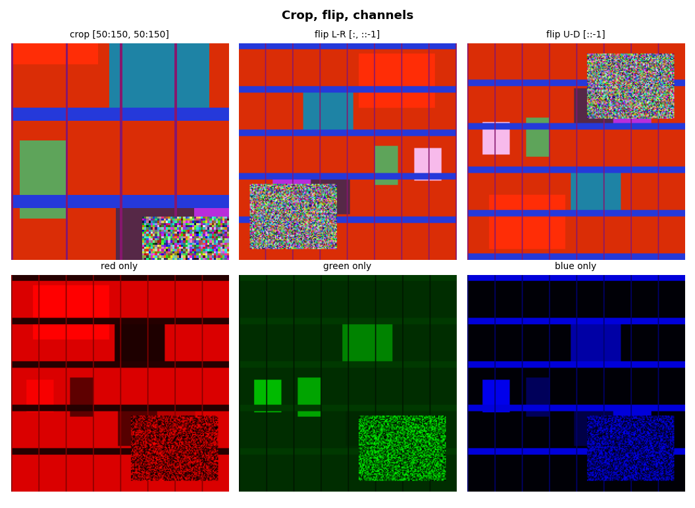
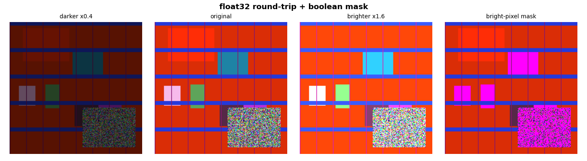
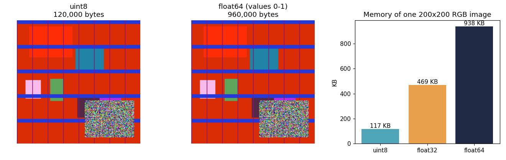

<h1 align="center">🎨 PixelForge</h1>
<p align="center"><b>A NumPy-only image pixel manipulator that creates, edits and filters synthetic images, with different random output on every run.</b></p>

<p align="center">
  <a href="https://colab.research.google.com/github/riyajethwani2004-code/Image_Pixel_Manipulator/blob/main/image_pixel_manipulator.ipynb">
  
</a>
</p>

---

## 📌 Overview

An image is just a 3D array of shape `(height, width, 3)`. PixelForge treats it exactly that way: no PIL, no OpenCV, no SciPy. Every crop, flip, recolor and filter is plain NumPy array manipulation. Matplotlib is used only to display and save results.

Nothing is loaded from disk. All images are **synthetic**, created from random numbers and array slicing, so every run produces something new.

## 🖼️ Sample Output

**Filter library**: 11 filters built from scratch, applied to a random image



**Creating images**: `np.zeros`, `np.ones`, `np.full`, blocks, stripes and noise



**Crop, flip and channels**



**Brightness and boolean mask**



**Memory comparison**: `uint8` vs `float64` shown with `plt.imshow`, plus `nbytes` chart



*Sample images above were generated with `--seed 2026`.*

## ✨ Features

| # | Feature | NumPy concepts |
|---|---|---|
| 1 | Blank, white and solid-colour canvases | `np.zeros`, `np.ones`, `np.full`, `dtype=np.uint8` |
| 2 | Colour blocks, stripes and random noise | 3D slicing `img[10:60, 20:90, 0]`, step slicing `img[:, ::25]`, `np.random` |
| 3 | Crop, flip, rotate, channel extraction | negative-step slicing `[::-1]`, `img[..., c]` |
| 4 | Brighten and darken | `astype(np.float32)`, `np.clip`, cast back to `uint8` |
| 5 | Highlight bright pixels | boolean masking with an adaptive percentile threshold |
| 6 | Memory comparison | `nbytes` for `uint8` vs `float32` vs `float64`, displayed with `plt.imshow` |
| 7 | **11 filters built from scratch** | shifted slices, matrix multiply, `reshape` + `mean`, `np.roll` |
| 8 | **Seeded randomness** | `np.random.default_rng(seed)` for reproducible output |

## 🎲 Randomness and Reproducibility

Each run prints a seed:

```
Seed: 2026  (run `python pixel_toolkit.py --seed 2026` to reproduce)
```

- No seed (default) gives brand-new random output every run.
- `--seed 42` (any number) reproduces the exact same images.
- In the notebook, set `SEED = 42` in the first code cell.

## 🧰 Filter Library

All filters take an image array and return one, with no external image libraries.

| Filter | How it works |
|---|---|
| `grayscale` | weighted RGB dot product (0.299, 0.587, 0.114) |
| `invert` | `255 - img` |
| `sepia` | 3×3 colour matrix multiply |
| `edges` | Sobel operator using shifted slices |
| `blur` | box blur: average of k×k shifted copies |
| `pixelate` | reshape into blocks, average, repeat |
| `vignette` | radial distance mask via broadcasting |
| `noise` | Gaussian noise added in float, then clipped |
| `posterize` | integer-divide to reduce colour levels |
| `channel-swap` | random permutation of the RGB axis |
| `glitch` | per-channel `np.roll` plus shifted row bands |

## 🚀 Getting Started

**Option A: Google Colab (easiest)**
1. Click the **Open in Colab** badge above.
2. Choose **Runtime → Run all**.

**Option B: Local notebook**
```bash
git clone https://github.com/riyajethwani2004-code/image-pixel-manipulator.git
cd image-pixel-manipulator
pip install -r requirements.txt
jupyter notebook image_pixel_manipulator.ipynb
```

**Option C: Command line**
```bash
pip install -r requirements.txt
python pixel_toolkit.py                # random images, saved to outputs/
python pixel_toolkit.py --seed 42      # reproducible
```

**Use it as a library**
```python
from pixel_toolkit import make_rng, blocks_and_stripes, FILTERS

seed, rng = make_rng(42)
img = blocks_and_stripes(rng)
edges = FILTERS["edges"](img, rng)
glitched = FILTERS["glitch"](img, rng)
```

## 📁 Project Structure

```
Image_Pixel_Manipulator/
├── image_pixel_manipulator.ipynb   # Main Google Colab notebook
├── pixel_toolkit.py                # Image processing functions
├── requirements.txt                # Required Python libraries
├── outputs/                        # Sample output images (8 PNG files)
└── README.md                       # Project documentation
```

## 🧠 Key Takeaways

- Slicing replaces loops: cropping, flipping and channel extraction are one-liners.
- Cast to `float32`, clip to 0-255, then cast back to `uint8` when changing brightness.
- Boolean masks select pixels by condition without loops.
- Shifted slices give blur and edge detection; the reshape trick gives pixelation.
- `float64` uses 8× the memory of `uint8` for the same image.

## 🔧 Tech Stack

Python · NumPy · Matplotlib · Google Colab

---

<p align="center">If you found this useful, give it a ⭐</p>
